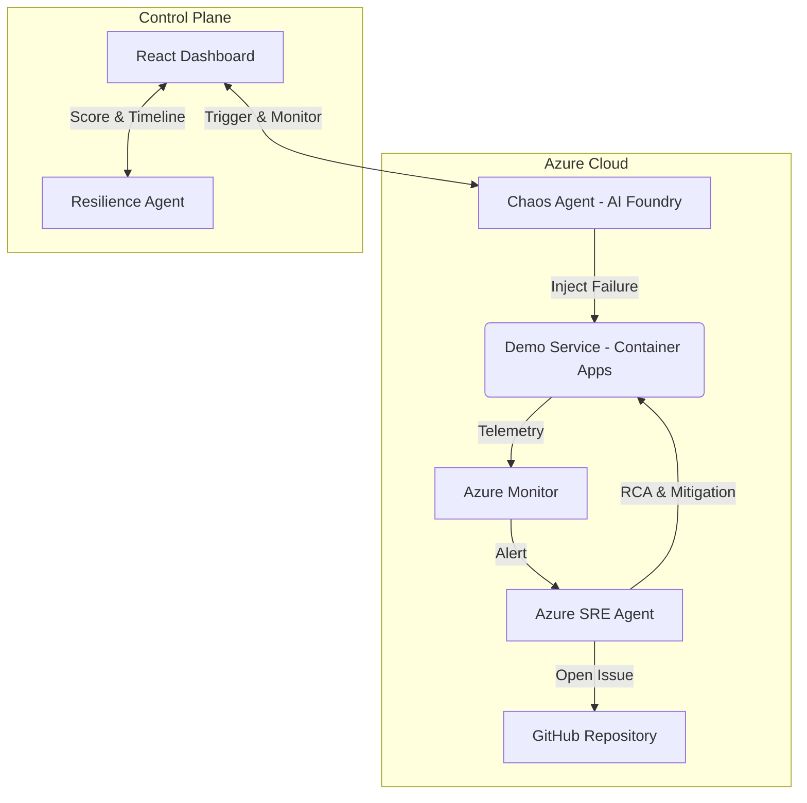

# 🚀 AutoSRE: Agentic Chaos Engineering & Autonomous Incident Response

**AutoSRE** is a next-generation SRE platform that leverages **Agentic AI** to proactively test system resilience and autonomously manage incident lifecycles. 

Built for the **Azure AI Dev Days Hackathon (Track 2: Automate and Optimize Software Delivery)**.

---

## 📺 Live Demo & Project Assets
- **2-Minute Demo Video:** Coming soon
- **Architecture Diagram:** See Mermaid diagram below
- **Elevator Pitch:** "AutoSRE turns the reactive 'firefighting' of DevOps into a proactive, self-healing loop by orchestrating Microsoft's most advanced AI agents."

---

## 🛡️ Hackathon Core Requirements Focus

| Requirement | Proof of Implementation |
| :--- | :--- |
| **🎨 Hero Technology** | Integrates **Azure SRE Agent** for autonomous remediation, **Azure AI Foundry** for custom agent reasoning, and **Azure MCP** for tool-to-agent communication. |
| **☁️ Azure Native** | Deployed on **Azure Container Apps**, monitored via **Azure Monitor**, and orchestrated by **Azure Functions** and **Event Grid**. |
| **💻 GitHub First** | Hosted on GitHub, leveraging **GitHub Copilot Agent Mode** for development and **GitHub Issues** integration via the SRE Agent. |

---

## 🧠 The Agentic Loop: How it Works

AutoSRE operates a continuous **Multi-Agent Control Loop**:

1.  **AI Chaos Agent (Azure AI Foundry)**: Evaluates the cluster state and injects controlled failures (e.g., CPU Spikes, pod restarts) to test specific SLOs.
2.  **Detection (Azure Monitor)**: Real-time telemetry detects performance degradation.
3.  **Autonomous Incident Commander (Azure SRE Agent)**: 
    *   **Root Cause Analysis (RCA)**: Automatically correlates logs and metrics.
    *   **Mitigation**: Executes remediation actions (rollbacks, restarts, scaling) via Azure CLI tools.
    *   **GitHub Integration**: Automatically opens a detailed GitHub Issue with the RCA and suggested code fixes.
4.  **Resilience Agent**: Analyzes the Time to Detection (TTD) and Time to Recovery (TTR) to generate a **Resilience Score** and strategic improvements.

---

## 🏗️ Architecture

---

## 📈 Judging Criteria Alignment

*   **Technological Implementation (20%)**: Uses a full-stack Azure native architecture with clean separation between microservices, agents, and observability.
*   **Agentic Design & Innovation (20%)**: Moving beyond simple scripts to a multi-agent system where agents "reason" about telemetry and collaborate on repairs.
*   **Real-World Impact (20%)**: Directly targets MTTR (Mean Time To Recovery) and operational toil—primary KPIs for any enterprise SRE team.
*   **User Experience (20%)**: A cinematic React dashboard provides a visual "War Room" experience, making complex backend automation transparent and understandable.
*   **Adherence to Category (20%)**: Specifically designed for Track 2, showcasing the newly released **Azure SRE Agent**.

---

## 🛠️ Getting Started

### Prerequisites
- Azure Subscription
- Azure CLI
- Node.js & Python 3.11

### Environment
Create a local `.env` from `.env.example` and adjust if needed:
- `DEMO_SERVICE_URL` (Chaos Agent target)
- `VITE_API_BASE_URL` (Dashboard API base)

### Quick Start (Local Demo)
1. **Start Demo Service**: `cd services/demo-service && pip install -r requirements.txt && python app.py`
2. **Start Dashboard**: `cd ui/dashboard && npm install && npm run dev`
3. **Run Chaos**: `cd agents/chaos-agent && pip install -r requirements.txt && python chaos_agent.py`

### One-Command Demo
Use the helper script to start the API + dashboard and run a smoke test:
`./scripts/demo.sh`

### Quick Start (Container Image)
1. **Build**: `cd services/demo-service && docker build -t auto-sre-demo .`
2. **Deploy**: Use `infra/main.bicep` with `containerImage` set to your pushed image

### Demo API
The dashboard reads its live data from the demo service API:
- `/state` for status and resilience score
- `/events` for the incident timeline
- `/cpu-spike` to trigger a chaos run

Full endpoint details live in `./docs/api.md`.

---

Built with ❤️ for the Azure AI Dev Days Hackathon 2026.
